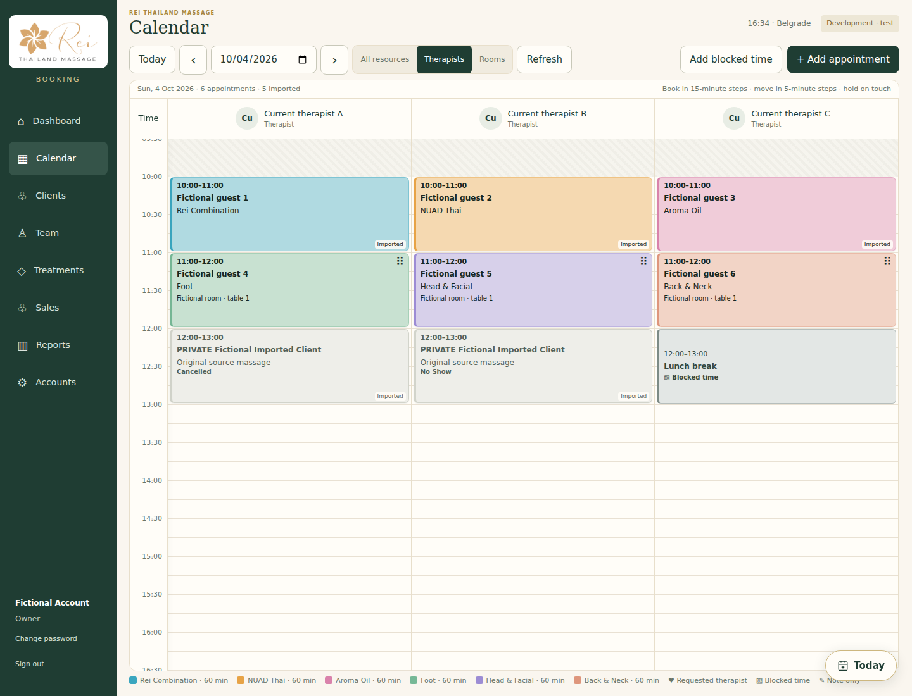
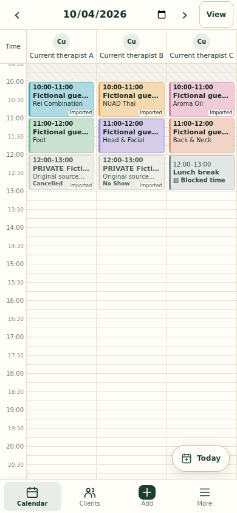

# Treatment colours — 0.18.2

The calendar uses stronger pastel fills, a coloured edge and dark time/name text. Both native and imported cards use the persisted treatment colour. Cancelled and no-show history stays neutral with its status label; blocked time stays grey. Names and statuses remain visible so colour is not the only cue.

## Palette

| Family                 | Colour    | Hex       |
| ---------------------- | --------- | --------- |
| Rei Combination        | Turquoise | `#3aa6bf` |
| NUAD Thai              | Amber     | `#e7a346` |
| Relaxing Aroma Oil     | Rose      | `#d982ab` |
| Foot                   | Sage      | `#76b896` |
| Head & Facial          | Lavender  | `#9c8cd4` |
| Back, Neck & Shoulders | Coral     | `#de967c` |
| Other treatments       | Blue      | `#729cc7` |

Duration variants use the same family. The owner can select a suggested swatch or any custom colour under **Treatments → Edit → Calendar colour**. The preview changes immediately; only Save persists the edit. Existing appointments retain their recorded name and price.

## Existing catalogue

On the first owner catalogue load in a Worker instance, the upgrade checks for legacy history-created services. It changes only the former default `#2e87a0` when the record is still version 1, was never updated, and has matching history-setup creation provenance. Each update and its before/after audit event are atomic and recheck the selected record. Version increments prevent a stale edit from overwriting the new value. Repeating the upgrade is harmless. Manual choices, including a manually saved old blue, remain authoritative.

New services created through reviewed history setup receive a family colour immediately. No source history, booking slots, treatment prices, staff availability or report rules are changed. No new schema or manual deployment command is required.

## Independent review handoff

Rendered with fictional records in the actual application:

The requested external Claude review has not been performed by this implementation session. Review these areas:

- `src/treatment-colours.mjs`: family naming variants, upgrade provenance, optimistic guards, audit atomicity and repeat safety.
- `src/history-salon.mjs` and `src/worker.mjs`: persisted colours on creation, owner-only legacy initialization, catalogue palette output.
- `public/app.js` and `public/app.css`: native/custom colour editing, preview, Save/Cancel, calendar fill and contrast on phone and desktop.
- `tests/treatment-colours.test.mjs`: actual Worker/D1 upgrade and preservation cases.
- Existing calendar browser scripts: populated fictional desktop/phone calendars, neutral statuses/blocks, text contrast, swatch save and cancel.

The three-column phone layout, 15-minute empty-slot selection and 5-minute movement are unchanged. Browser emulation does not replace checking a physical iPhone/Safari. Live salon data should not be copied into review fixtures.
